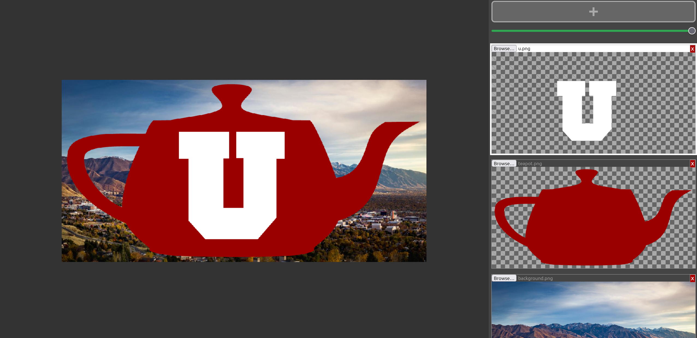
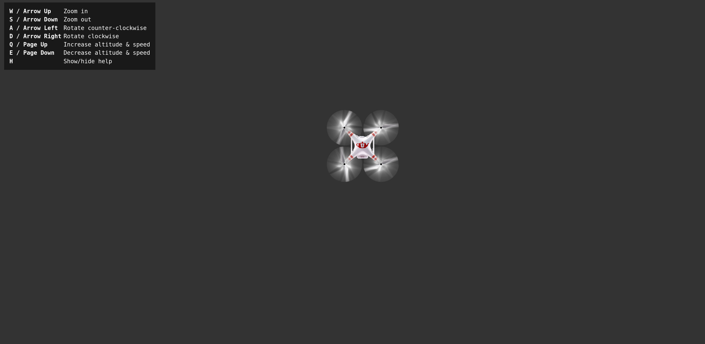
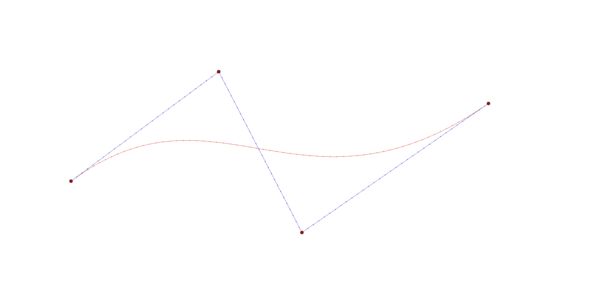
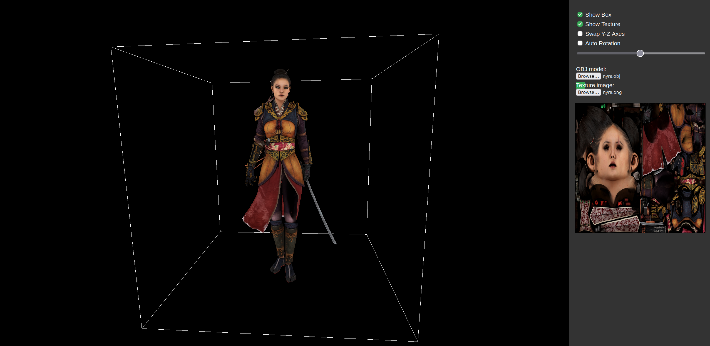
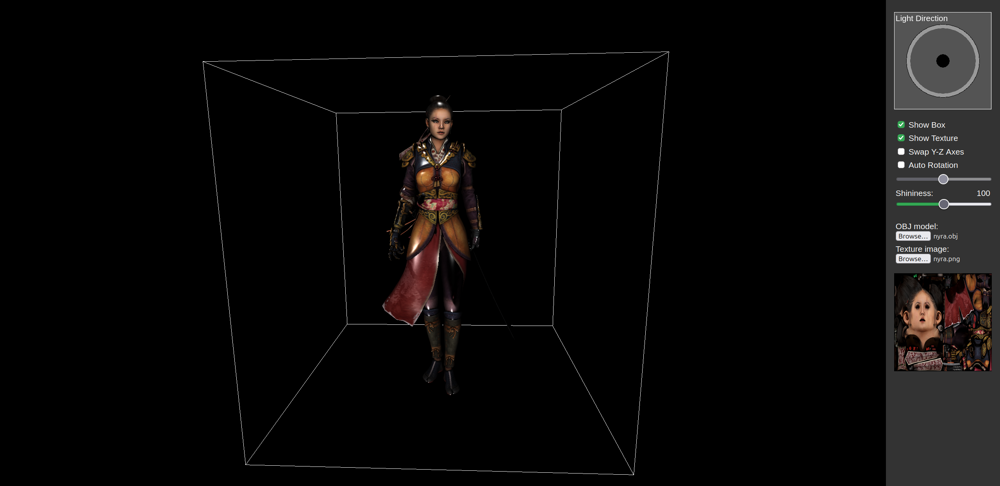
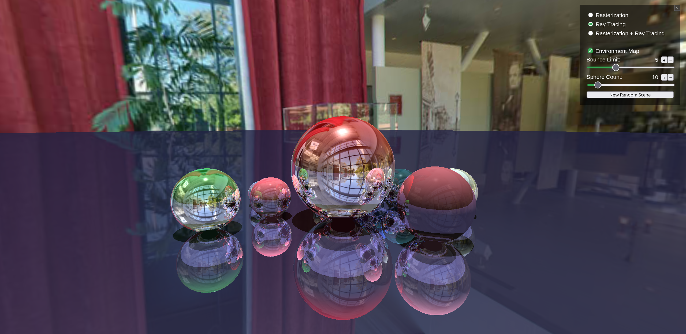
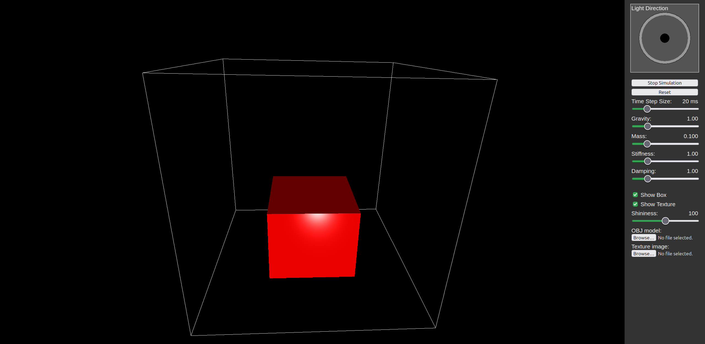

# Intro to Computer Graphics Course projects (WebGL)

7 projects from computer graphics course [University of Utah](https://graphics.cs.utah.edu/courses/cs4600/fall2026/).

## Project 1 (Compositing Images)

## Project 2 (Transformations)

## Project 3 (Curves)

## Project 4 (Triangular Meshes)

## Project 5 (Shading)

## Project 6 (Ray Tracing)

## Project 7 (Animation)
